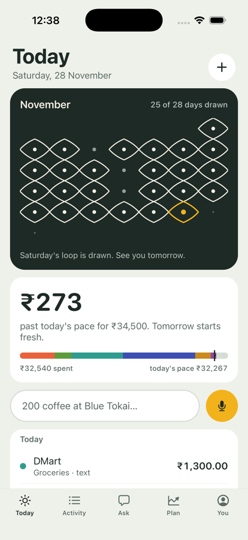
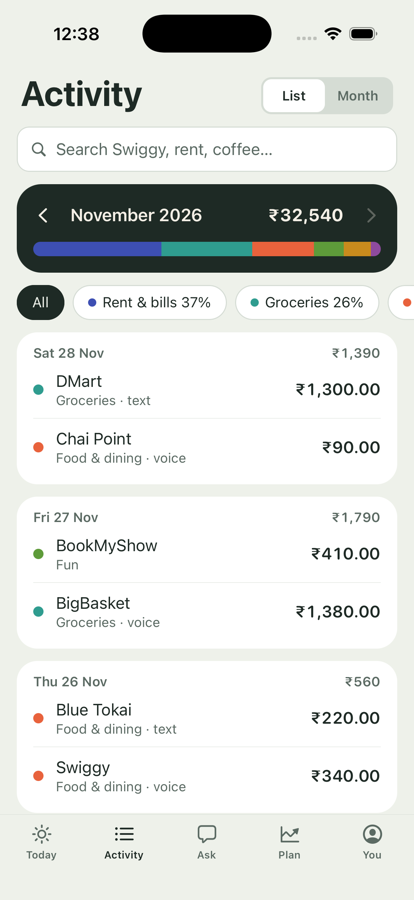
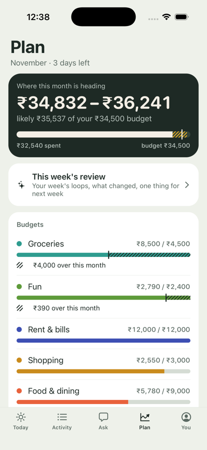
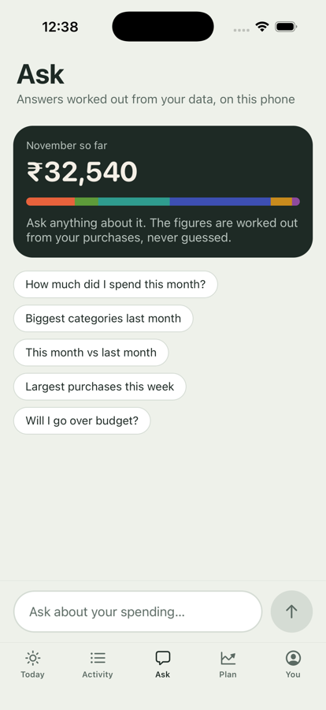
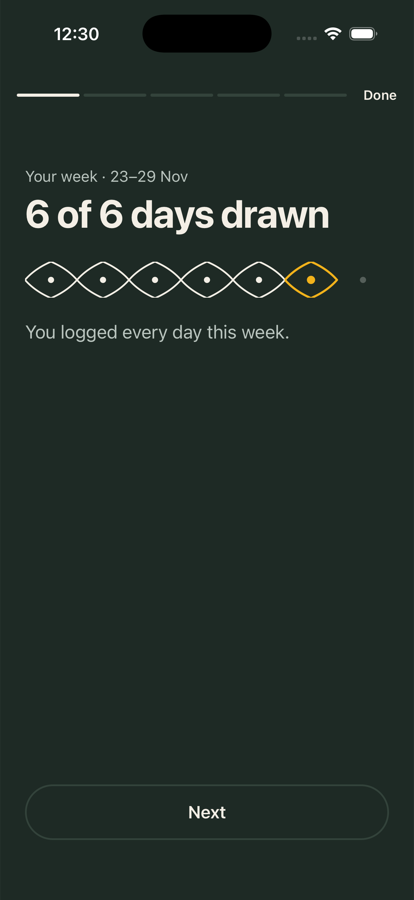
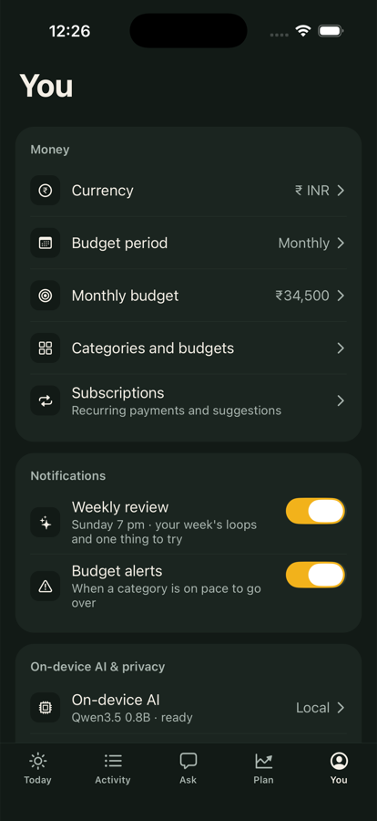

# 💸 Finance Tracker

<p align="center">
  <strong>A private, on-device-AI personal finance app for iPhone, built with React Native & Expo</strong>
</p>

<p align="center">
  Log a spend in one sentence, watch your month draw itself as a kolam, and get honest answers about your money — all on your phone.
</p>

<p align="center">
  
  
  
  
  <a href="LICENSE"></a>
</p>

---

## 📋 Table of Contents

- [Demo](#-demo)
- [Screenshots](#-screenshots)
- [Features](#-features)
- [Tech Stack](#️-tech-stack)
- [Getting Started](#-getting-started)
- [Project Structure](#-project-structure)
- [Database Schema](#️-database-schema)
- [Configuration](#-configuration)
- [Contributing](#-contributing)
- [Roadmap](#-roadmap)
- [License](#-license)
- [Acknowledgments](#-acknowledgments)

---

## 🎬 Demo

https://github.com/user-attachments/assets/8d667c59-0ede-4f05-bbe8-f6817ed2c1d8

*Full walkthrough — from onboarding to budget tracking, AI receipt scanning, and financial insights.*

---

## 📱 Screenshots

<table>
  <tr>
    <td align="center"><br /><strong>Today</strong><br /><em>The month kolam and what's left today</em></td>
    <td align="center"><br /><strong>Activity</strong><br /><em>Search, month bands, day groups</em></td>
    <td align="center"><br /><strong>Plan</strong><br /><em>Forecast, budgets, goals</em></td>
  </tr>
  <tr>
    <td align="center"><br /><strong>Ask</strong><br /><em>Questions answered on the phone</em></td>
    <td align="center"><br /><strong>Weekly review</strong><br /><em>A Sunday ritual</em></td>
    <td align="center"><br /><strong>You</strong><br /><em>Settings, in dark mode</em></td>
  </tr>
</table>

*Screenshots use synthetic demo data.*

---

## ✨ Features

**Daily Kolam.** Each day you log draws one loop of the month's kolam. Skipped days stay as dots and the pattern keeps going: no streak that resets, no guilt.

### 🌞 Today
- The month kolam: logged days join into a lattice; today's loop draws itself when the day closes
- What's left today to stay on pace, with exact category bands
- One-line log bar with a mic, and **Nothing spent today** to close a quiet day

### ✍️ Log anything in one sentence
- Type or say *"250 uber yesterday"*: amount, what, when and category fill in as you go
- Categories are learned from your own corrections, with starter guesses for new merchants
- Duplicate and unusually large purchases are flagged before you save (never blocked)
- Receipt scanning (optional, with your own Gemini key) and manual entry in the same sheet

### 📜 Activity
- Search across merchants, items, notes and categories; long questions hand off to Ask
- Month switcher, exact category shares, filter chips, day groups with totals
- Month grid view; edit or delete any purchase

### 💬 Ask (on-device AI)
- *"Biggest categories last month"*, *"This month vs last month"*, *"Will I go over budget?"*
- The model only picks a query type; the app computes every number from your data, and any model sentence containing a number not in the result is discarded
- Tap a bar or purchase in an answer to open it in Activity

### 📈 Plan
- Where the month is heading: a forecast range, not a guess dressed as certainty
- Budgets per category (over budget is hatched and named, never shamed in red)
- **Savings goals** with plain arithmetic: *"₹3,000 a month gets you there by 27 Feb"*
- Upcoming subscription charges and suggestions to track repeat payments
- **Weekly review** every Sunday: your week's loops, what changed, one thing to try

### 🙋 You
- Currency, budget period and total, appearance, Face ID lock
- On-device AI: Apple Intelligence, a downloadable local model (Qwen3.5 0.8B), or off
- Weekly review and budget alert notifications (local, nothing leaves the phone)
- Export the month as a PDF; erase all data

### 🔒 Private by construction
All data lives in SQLite on the phone. Categorising, forecasting, questions and summaries run on the device. The only network use is the optional model download and, if you choose, receipt scanning with Gemini.

---

## 🛠️ Tech Stack

| Layer | Technology |
| :--- | :--- |
| **Framework** | React Native 0.81 (New Architecture) + Expo SDK 54 |
| **Language** | TypeScript 5.9 |
| **Navigation** | Expo Router (native tabs and modal sheets) |
| **State** | Zustand |
| **Database** | expo-sqlite with versioned migrations |
| **On-device AI** | AI SDK + `@react-native-ai/apple` (Apple Intelligence) and `@react-native-ai/llama` / `llama.rn` (local GGUF) |
| **Speech** | expo-speech-recognition (on-device) |
| **Design system** | `src/ui` (Daily Kolam tokens and components), SF Symbols via expo-symbols, react-native-svg + Reanimated |
| **Notifications** | expo-notifications (local only) |
| **Tests** | Jest (jest-expo), sql.js for real SQLite in tests |

---

## 🚀 Getting Started

### Prerequisites

| Requirement | Version |
| :--- | :--- |
| Node.js | 18+ |
| npm or yarn | Latest |
| Xcode | 15+ (for iOS development) |
| CocoaPods | Latest (`sudo gem install cocoapods`) |
| iOS Device / Simulator | iOS 16+ recommended |

### Installation

1. **Clone the repository**

   ```bash
   git clone https://github.com/ayush-343/FinanceTracker.git
   cd FinanceTracker
   ```

2. **Install dependencies**

   ```bash
   npm install
   ```

3. **Install iOS pods**

   ```bash
   cd ios && pod install && cd ..
   ```

4. **(Optional) Set up Gemini API Key**

   Create a `.env` file in the project root:

   ```env
   GEMINI_API_KEY=your_api_key_here
   ```

   Or configure it in-app via **You → Gemini key for receipts**.

### Running the App

```bash
npm test                     # unit tests
npx expo run:ios             # development build on the simulator
```

**On your iPhone, without the Mac (Release build):**

```bash
LANG=en_US.UTF-8 npx expo run:ios --device <your-device> --configuration Release
```

Then on the phone: **Settings → General → VPN & Device Management → Trust** your developer certificate. With a free Apple account the build expires after 7 days. The app uses local notifications only, so `plugins/withoutPushEntitlement.js` removes the push capability that free accounts cannot sign.

If CocoaPods fails with an encoding error, set `export LANG=en_US.UTF-8`.

---

## 📁 Project Structure

```
app/
  (tabs)/          Today, Activity, Ask, Plan, You (+ Subscriptions)
  (onboarding)/    Start: three steps ending with day one
  Log.tsx          one sheet for logging, scanning and editing
  Goal.tsx         savings goals
  Review.tsx       the weekly review
src/
  ui/              Daily Kolam design system (tokens, Kolam, Bands, Field, ...)
  ai/              categorizer, engines, quick log, Ask, forecast, insights
  today/ activity/ plan/ review/ log/ onboarding/   screen logic (pure, tested)
  database/        SQLite, migrations, queries
  services/        notifications, PDF report, receipt scanning
docs/superpowers/  specs and implementation plans
DESIGN.md          the design system;  PRODUCT.md  product context
```

---

## 🗄️ Database Schema

| Table | Purpose |
| :--- | :--- |
| `categories`, `subcategories`, `items` | Categories with budgets, nested items |
| `transactions` | Purchases, with `merchant` and `source` (manual, text, voice, scan) |
| `subscriptions`, `subscription_skips` | Recurring payments |
| `category_memory` | What the app has learned about your categories |
| `day_marks` | "Nothing spent today" days for the kolam |
| `goals` | Savings goals |

Schema changes go through `src/database/migrations.ts` (`PRAGMA user_version`), so existing installs upgrade in place.

---

## 🔧 Configuration

### Currencies

Edit `src/constants/index.ts` to add more currencies:

```typescript
export const CURRENCIES = [
  { code: "USD", symbol: "$", name: "US Dollar" },
  { code: "EUR", symbol: "€", name: "Euro" },
  { code: "INR", symbol: "₹", name: "Indian Rupee" },
  // Add more currencies here
];
```

### Default Categories

Default categories are defined in `src/constants/index.ts`:

```typescript
export const DEFAULT_CATEGORIES = [
  { name: "Food & Dining", icon: "coffee", color: "#FF6B6B" },
  { name: "Transportation", icon: "truck", color: "#4ECDC4" },
  // Add more categories here
];
```

### Gemini API Key

The app supports **Bring Your Own API Key** for AI-powered receipt scanning. Configure it via:

- **In-app:** You → Gemini key for receipts
- **Environment variable:** Add `GEMINI_API_KEY` to your `.env` file

---

## 🤝 Contributing

Contributions are welcome and greatly appreciated! This is an open source project and every contribution helps.

### How to Contribute

1. **Fork** the repository
2. **Create** your feature branch
   ```bash
   git checkout -b feature/amazing-feature
   ```
3. **Commit** your changes using [Conventional Commits](https://www.conventionalcommits.org/)
   ```bash
   git commit -m "feat: add amazing feature"
   ```
4. **Push** to the branch
   ```bash
   git push origin feature/amazing-feature
   ```
5. **Open** a Pull Request

### Contribution Ideas

Here are some ways you can contribute:

- 🐛 **Bug Reports** — Found a bug? Open an [issue](https://github.com/ayush-343/FinanceTracker/issues)
- 💡 **Feature Requests** — Have an idea? Start a [discussion](https://github.com/ayush-343/FinanceTracker/discussions)
- 📖 **Documentation** — Improve docs, add examples, fix typos
- 🧪 **Testing** — Add unit tests or integration tests
- 🌍 **Localization** — Help translate the app into other languages
- 🎨 **Design** — Suggest UI/UX improvements

### Development Guidelines

- Follow the existing code style and project structure
- Write meaningful commit messages using [Conventional Commits](https://www.conventionalcommits.org/)
- Test your changes on an iOS simulator or physical device before submitting
- Update documentation if your changes affect the public API or user-facing features

---

## 🗺️ Roadmap

- [x] On-device AI: learned categories, one-sentence logging, Ask, forecasts
- [x] Savings goals and the weekly review
- [ ] Restyle the remaining legacy screens (Subscriptions, category editing)
- [ ] Home Screen widget and Siri shortcut for logging
- [ ] Shareable month-end kolam
- [ ] Income tracking
- [ ] Android release
- [ ] Encrypted backup

---

## 📄 License

This project is licensed under the **MIT License** — see the [LICENSE](LICENSE) file for details.

You are free to use, modify, and distribute this software. Contributions back to the project are always appreciated!

---

## 🙏 Acknowledgments

- [Expo](https://expo.dev/) — React Native development platform
- [React Navigation](https://reactnavigation.org/) — Navigation library
- [Zustand](https://zustand-demo.pmnd.rs/) — Lightweight state management
- [react-native-gifted-charts](https://github.com/Abhinandan-Kushwaha/react-native-gifted-charts) — Beautiful chart components
- [Google Gemini](https://ai.google.dev/) — AI-powered receipt scanning
- [LottieFiles](https://lottiefiles.com/) — Animation assets

---

<p align="center">
  <strong>Built with ❤️ by <a href="https://github.com/ayush-343">Ayush Srivastava</a></strong>
  <br />
  React Native • Expo • TypeScript • Gemini AI
</p>

<p align="center">
  ⭐ Star this repo if you find it useful!
</p>
